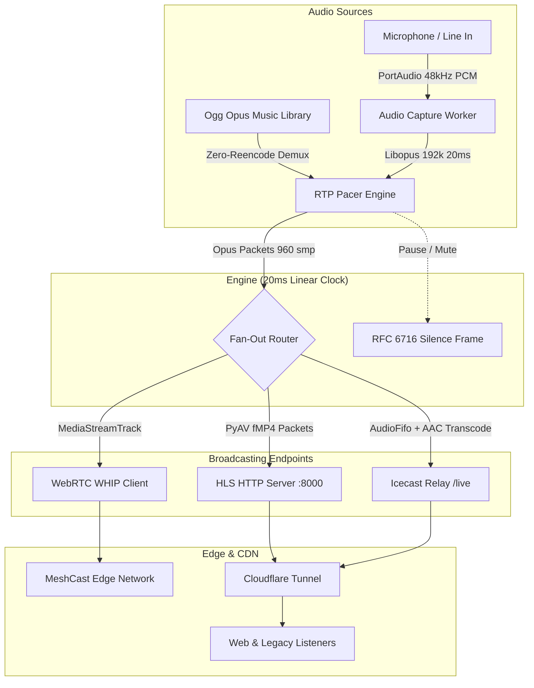

# LSNN Radio — MeshCast Multi-Streamer

A high-performance, lightweight desktop audio broadcasting application. Broadcast music and live microphone audio simultaneously across **WebRTC (MeshCast)**, **fMP4 HLS**, and a **Native AAC Icecast Relay** with built-in Cloudflare Tunnel support.

---

## Architecture & Dataflow



---

## Features

### 1. Audio Engine & Pacing
- **Zero-Reencode Music Playback**: Demuxes `.opus` files directly without decoding to PCM, keeping CPU usage near 0% and preserving bit-exact audio quality.
- **Low-Latency Microphone Capture**: Non-blocking PortAudio worker with ~100ms ring buffer, automatic mono-to-stereo upmixing, and Windows WDM-KS crash protection.
- **Strict 20ms RTP Pacer**: `MediaStreamTrack` subclass generating 50 pps with linear PTS increments (`+960` @ 48 kHz) and clock-resync protection against event-loop lag.
- **Hardware-Level Precision Timer**: Integrates Windows Multimedia `timeBeginPeriod(1)` to lock system scheduler resolution to 1ms, preventing timer drift and WebRTC underruns.
- **Continuous Stream Injection**: Injects standard Opus comfort noise frames (`b'\xf8\xff\xfe'`) during pause/mute to keep WebRTC and HLS sessions alive.

### 2. Multi-Protocol Broadcasting
- **WebRTC WHIP (MeshCast)**: Ultra low-latency broadcast using RFC draft WHIP ingest with asynchronous event-driven ICE gathering and exponential backoff auto-reconnect (1s–30s).
- **fMP4 HLS Streamer**: Low-latency HLS with 2-second fMP4 segments, unique session epoch timestamps (`init_{session}.mp4`) to prevent CDN cache collisions, CORS preflight `OPTIONS` support, and in-memory M3U8 caching.
- **Native AAC Icecast Relay (`/live`)**: Built-in HTTP audio relay serving continuous ADTS-framed AAC-LC (128 kbps). Features `av.AudioFifo` frame alignment, instant-play pre-buffering (50 chunks), and socket write coalescing. Zero CPU cost when disabled.

### 3. Queue Management & Auto-DJ
- **Two-Tier Queue System**: Priority User Queue (Play Next / Add to Queue) processed ahead of the background pool.
- **Smart Auto-DJ**: Cryptographically seeded shuffle pool (`random.SystemRandom`) with repeat-prevention logic for back-to-back tracks.
- **Full Transport Controls**: Instant Play/Pause, Mute toggle, Next/Prev track, and manual Auto-DJ pool reshuffling.

### 4. Audio Ingestion & Conversion
- **YouTube Downloader**: Paste any YouTube link to download and enqueue audio automatically. Sanitizes URL query parameters (strips playlist IDs), enforces 15s socket timeouts, and ignores live streams.
- **Batch Audio Converter**: Scans and converts non-Opus files (`.mp3`, `.wav`, `.flac`, `.m4a`, `.aac`, `.wma`) to streaming-compliant 48kHz stereo Opus. Uses FFmpeg CLI if installed, or falls back to pure PyAV C-bindings with NumPy sample alignment and padding.

### 5. Cloudflare Tunnel Integration
- **Quick Tunnels**: Instantly generates a public `*.trycloudflare.com` URL with isolated configuration—no account or local port-forwarding required.
- **Custom Named Tunnels**: Supports production Cloudflare Tunnels using existing YAML configs and Tunnel IDs with active connector health checks.
- **Automatic Binary Discovery**: Auto-detects `cloudflared` from system PATH, Program Files, local directories, or Linux bin paths.

### 6. Modern PySide6 Desktop GUI
- **Minimalist Dark Interface**: Integrated with `qasync` for a non-blocking asynchronous Qt event loop.
- **Split Library / Queue View**: Searchable music library with right-click context actions (*Play Now*, *Play Next*, *Properties*, *Show in Explorer*) alongside an interactive reorderable queue.
- **Live Visual Telemetry**:
  - Hardware microphone VU meter with linear & dB scale (`-60 dB` to `0 dB`).
  - Real-time stream telemetry: Instant Bitrate, Uptime, Total Data Sent, WebRTC connection state, and Active Listeners.
- **Collapsible Log Drawer**: Integrated event log with automatic memory cap (maximum 500 lines).
- **In-App Settings Dialog**: Configure ports, host bindings, audio directories, and tunnel modes with atomic file persistence (`.tmp` + atomic replace).

---

## Technical Specifications

| Parameter | Music Playback | Microphone Input | WebRTC (WHIP) | HLS Stream | Icecast Relay (`/live`) |
| :--- | :--- | :--- | :--- | :--- | :--- |
| **Codec** | Opus (Ogg container) | Opus (`libopus`) | Opus (RTP) | Opus (`fmp4`) | AAC-LC (ADTS) |
| **Sample Rate** | 48,000 Hz | 48,000 Hz | 48,000 Hz | 48,000 Hz | 48,000 Hz |
| **Channels** | 2 (Stereo) | 2 (Stereo upmixed) | 2 (Stereo) | 2 (Stereo) | 2 (Stereo) |
| **Bitrate** | Source Bitrate | 192 kbps | Variable / ~192k | Variable / ~192k | 128 kbps (CBR) |
| **Frame Size** | 20 ms (960 samples) | 20 ms (960 samples) | 20 ms (50 pps) | 2.0s segments | 1024 samples/frame |
| **Latency** | Local Demux | ~100 ms buffer | ~50–200 ms | ~4–8 seconds | ~1–3 seconds |

---

## Requirements

- Python 3.12 or newer
- Windows 10/11 or Linux
- [uv](https://github.com/astral-sh/uv) (recommended) or `pip`
- *Optional*: `ffmpeg` (for faster audio conversions) and `cloudflared` (for public tunneling)

---

## Installation & Running

1. **Clone the repository:**
   ```bash
   git clone https://github.com/rahulbhatara/lsnn-radio.git
   cd lsnn-radio
   ```

2. **Install dependencies:**
   ```bash
   uv sync
   ```

3. **Launch the application:**
   ```bash
   uv run python main.py
   ```

---

## Configuration

Settings can be managed directly in the application (**Settings** button) or via `config.json`:

| Key | Type | Default | Description |
| :--- | :--- | :--- | :--- |
| `music_dir` | `string` | `".."` | Directory containing your local audio library |
| `whip_url` | `string` | `https://cn1.meshcast.io/whip/lsnn_radio` | WebRTC WHIP ingestion endpoint |
| `hls_host` | `string` | `"0.0.0.0"` | Network interface to bind HTTP services |
| `hls_port` | `integer` | `8000` | Local TCP port for HLS and Icecast streaming |
| `public_hls_url` | `string` | `https://radio.samf.fun/live.m3u8` | Publicly accessible HLS stream URL |
| `tunnel_mode` | `string` | `"quick"` | Cloudflare tunnel mode: `"quick"`, `"custom"`, or `"none"` |
| `cloudflared_config_path` | `string` | `""` | Path to Cloudflare YAML config (for `custom` mode) |
| `cloudflared_tunnel_id` | `string` | `""` | UUID or tunnel name (for `custom` mode) |

---

## Project Structure

```
lsnn-radio/
├── main.py                 # Application lifecycle, qasync loop & WinMM precision timer
├── config.example.json     # Configuration template
├── pyproject.toml          # Project dependencies & tool configurations
└── src/
    ├── config.py           # Dataclass settings manager with atomic writes
    ├── rtp_pacer.py        # 20ms real-time audio pacer, priority queue & Auto-DJ
    ├── opus_demuxer.py     # Zero-reencode Ogg Opus frame parser & metadata stripper
    ├── audio_capture.py    # PortAudio microphone capture & real-time Opus encoder
    ├── whip_client.py      # WebRTC WHIP ingestion client with auto-reconnect
    ├── hls_streamer.py     # PyAV fMP4 segmenter & aiohttp web server
    ├── icecast_server.py   # Native AAC-LC Icecast relay at /live (AudioFifo + ADTS)
    ├── service_manager.py  # Cloudflared subprocess lifecycle & quick tunnel monitor
    ├── yt_downloader.py    # YouTube audio downloader (yt-dlp + PyAV transcode fallback)
    ├── convert_playlist.py # Batch audio converter to 48kHz stereo Opus
    └── gui/
        ├── main_window.py     # PySide6 main window, dual tables & live telemetry
        ├── settings_dialog.py # In-app configuration dialog
        └── theme.py           # Dark UI styling & color constants
```

---

## License

MIT License
