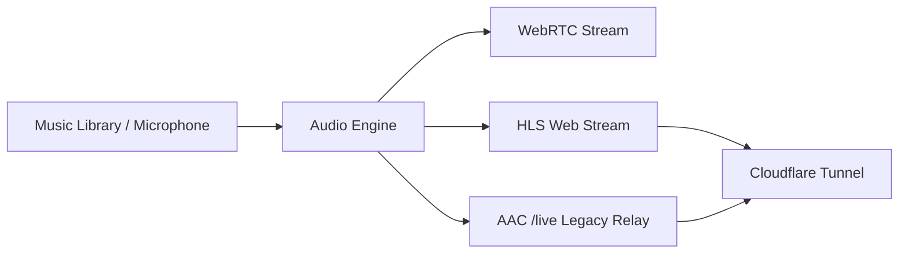

# MeshCast Dual Streamer

A lightweight desktop audio broadcasting application. Stream music and live microphone audio simultaneously to WebRTC (MeshCast) and HLS web players.

---

## Features

- **Dual Audio Sources**: Switch easily between a music library and a live microphone input.
- **Dual Streaming**: Broadcasts to both WebRTC for real-time streaming and HLS for web browsers.
- **Legacy AAC Relay**: Optional native Icecast-compatible AAC stream at `/live` for listeners that cannot play Opus/HLS (off by default, enable from the bottom bar).
- **YouTube Downloader**: Paste a YouTube link to download audio and add it directly to your queue.
- **Auto-DJ & Queue**: Automatic playback with custom priority queue and shuffle support.
- **Audio Converter**: Convert MP3, WAV, and FLAC files into streaming-ready Opus audio.
- **In-App Settings**: Change stream URLs, ports, tunnel modes, and music folders directly from the GUI.
- **Cloudflare Support**: Built-in support for Quick Tunnels and custom named tunnels.

---

## How It Works



The optional legacy relay transcodes the 20ms Opus packets to AAC-LC on the fly
and serves a continuous Icecast-style stream at `/live`. It works in VLC and any
traditional radio player. Enable it with the **AAC** button in the bottom bar;
it is off by default.

---

## Requirements

- Python 3.12 or newer
- [uv](https://github.com/astral-sh/uv) (recommended package manager)

---

## Installation & Running

1. Clone the repository:
   ```bash
   git clone https://github.com/rahulbhatara/lsnn-radio.git
   cd lsnn-radio
   ```

2. Install dependencies:
   ```bash
   uv sync
   ```

3. Start the application:
   ```bash
   uv run python main.py
   ```

---

## Configuration

Settings can be changed from the **Settings** button in the app or via `config.json`:

| Setting | Default | Description |
| :--- | :--- | :--- |
| `music_dir` | `..` | Folder containing your audio files |
| `whip_url` | `https://cn1.meshcast.io/whip/lsnn_radio` | WebRTC broadcast endpoint |
| `hls_port` | `8000` | Local HTTP port for HLS streaming |
| `public_hls_url` | `https://radio.samf.fun/live.m3u8` | Public HLS stream address |
| `tunnel_mode` | `quick` | Cloudflare tunnel mode (`quick`, `custom`, or `none`) |

---

## Project Structure

```
Streaming MeshCast/
├── main.py              # Application entry point
├── pyproject.toml       # Project dependencies and configuration
├── src/
│   ├── config.py        # Settings manager
│   ├── rtp_pacer.py     # Core audio stream engine
│   ├── opus_demuxer.py  # Zero-reencode Ogg Opus packet reader
│   ├── whip_client.py   # WebRTC broadcast client
│   ├── hls_streamer.py  # HLS HTTP stream server
│   ├── icecast_server.py # Native AAC/Icecast relay at /live (optional)
│   ├── audio_capture.py # Microphone input recorder
│   ├── service_manager.py # Cloudflare tunnel manager
│   ├── yt_downloader.py # YouTube audio downloader
│   ├── convert_playlist.py # Audio format converter
│   └── gui/             # Desktop user interface
```

---

## License

MIT License
