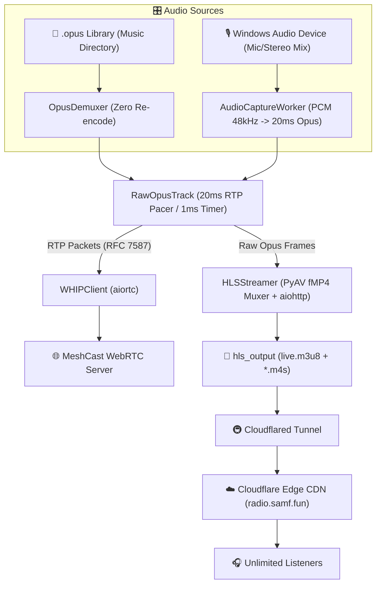

# Streaming MeshCast (Opus WHIP & HLS Dual Streamer)

<p align="center">
  <a href="#-quick-start"></a>
  <a href="#-architecture"></a>
  <a href="#-architecture"></a>
  <a href="#-quick-start"></a>
  <a href="#-quick-start"></a>
</p>

A bit-exact, ultra-low latency dual audio broadcasting engine. Streams raw Opus frames simultaneously to **WebRTC / WHIP (MeshCast)** and **HLS (fMP4 Opus)** via Cloudflare Edge CDN with **Zero Re-encoding (Music Mode)** and **Real-Time 20ms Live Audio Encoding (Microphone / Windows Audio Mode)**.

---

## 🌟 Key Highlights

- 🎙️ **Dual Source Mode Switcher**:
  - **🎵 Native Opus Music Library**: Demuxes raw 20ms Opus frames directly from `.opus` files with **Zero Re-encoding (Zero CPU)**.
  - **🎙️ Live Microphone / Windows Audio Device**: Real-time PCM capture from any Windows Audio Device (Microphone, Stereo Mix, Virtual Audio Cable) converted to standard 48kHz stereo and encoded directly into 20ms Opus packets via `PyAV / libopus`.
- 📡 **Simultaneous Dual Streaming**:
  - **WebRTC / WHIP**: Ultra-low-latency real-time ingestion (`cn1.meshcast.io/whip/lsnn_radio`).
  - **HLS fMP4 (Cloudflare Edge CDN)**: Generates RFC 8216 fMP4 Opus segments (`.m4s`) cached at the Cloudflare Edge (`https://radio.samf.fun/live.m3u8`), serving unlimited listeners with single-upload bandwidth (~128–192 kbps).
- 🖥️ **Modern Desktop GUI (PySide6)**:
  - Sleek minimalist dark UI with live playback controls, volume/track sliders, interactive audio device selection, live VU / signal meter, real-time WebRTC & HLS telemetry, and interactive playlist search.
- 📥 **Background YouTube Downloader**: Fetch songs directly from YouTube/YouTube Music (`Paste URL`), automatically convert to standard 48kHz Opus, and queue them as the **Next Song** on-the-fly without interrupting the live broadcast.
- 🔄 **Continuous Stream & Silence Injection**: Injects Opus silence frames (`b'\xf8\xff\xfe'`) during pause/mute to keep WebRTC peer connections and HLS stream timing synchronized and active.
- 🚀 **Auto Cloudflared Service Manager**: Automatically detects and manages the Cloudflared tunnel lifecycle on start and clean exit.

---

## 🏗️ Architecture



---

## 🚀 Quick Start

### 1. Prerequisites
- **Python 3.12+**
- **[uv](https://github.com/astral-sh/uv)** (recommended fast Python package manager)
- **ffmpeg** (for audio conversion and YouTube downloads)
- **[Cloudflared](https://developers.cloudflare.com/cloudflare-one/connections/connect-networks/downloads/)** *(optional, for public HLS CDN tunneling)*

### 2. Installation
Clone the repository and install dependencies using `uv`:

```bash
git clone https://github.com/your-username/streaming-meshcast.git
cd "Streaming MeshCast"
uv sync
```

### 3. Running the Broadcaster

Place your `.opus` music files in the parent directory (`..`) or specify a custom music folder:

```bash
uv run python main.py
```

---

## ⚙️ CLI Options

| Argument | Default | Description |
| :--- | :--- | :--- |
| `--dir` | `..` | Directory containing `.opus` music files |
| `--url` | `https://cn1.meshcast.io/whip/lsnn_radio` | Target WebRTC WHIP endpoint |
| `--public-url` | `https://radio.samf.fun/live.m3u8` | Public HLS CDN stream URL |
| `--hls-port` | `8000` | Local HTTP server port for HLS segments |

---

## 🛠️ Utility Scripts

### 🎵 Batch Audio Normalization
Convert existing `.mp3`, `.wav`, `.flac`, or `.m4a` files into streaming-standard Opus format (48kHz, 20ms frames, 192 kbps):

```bash
uv run python convert_playlist.py --dir "C:\path\to\music"
```

---

## 📁 Project Structure

```
Streaming MeshCast/
├── main.py               # Main entrypoint & PySide6 GUI lifecycle (qasync)
├── gui_app.py            # Modern PySide6 desktop GUI with Source Switcher & VU Meter
├── audio_capture.py      # Real-time Windows Audio Device capture & Opus 20ms encoder
├── rtp_pacer.py          # High-precision 20ms Opus RTP pacer & dual-mode streamer
├── opus_demuxer.py       # Zero-copy PyAV Opus packet demuxer
├── whip_client.py        # WebRTC WHIP ingestion client (aiortc)
├── hls_streamer.py       # Low-overhead fMP4 HLS segmenter & aiohttp server
├── service_manager.py    # Cloudflared tunnel process manager
├── yt_downloader.py      # Background YouTube audio downloader & Opus encoder
├── convert_playlist.py   # Batch audio to Opus converter utility
└── pyproject.toml        # Project metadata and dependencies
```

---

## 📄 License

This project is licensed under the [MIT License](LICENSE).
